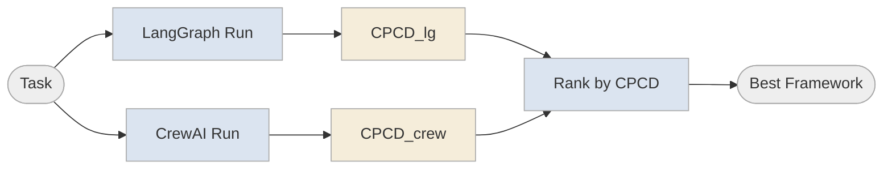

# `[cpcd]-[multi]-[ollama]` — CPCD Decision Economics

> **Category**: Decision Economics | **Pattern**: CPCD | **Framework**: Multi | **Backend**: Ollama


## Pattern Diagram



## What This Example Demonstrates

The benchmarking hub of the repo. Runs the same task through multiple frameworks, scores each, and ranks by CPCD:

```
CPCD = token_cost_usd / quality_score
```

## Quick Start

```bash
cd decision-econ/[cpcd]-[multi]-[ollama]
python agent.py
python agent.py "Find a Python data science book, check availability."
```

## Expected Output

```
──────────────────────────────────────────────────────────────────────────
 CPCD Pareto Comparison — lower CPCD = better value
──────────────────────────────────────────────────────────────────────────
#    Framework                              Score    Cost (USD)   CPCD (USD)
──────────────────────────────────────────────────────────────────────────
1    LangGraph · ReAct · Ollama             0.831    $0.000000    $0.000000
2    CrewAI · FW-Swap · Ollama             0.762    $0.000000    $0.000000
```

> **Note**: With Ollama, all costs are $0.00 so CPCD = $0. Swap to a paid backend to see real CPCD differences.

## When NOT to Use CPCD

- When all runs are free — rank by quality only
- When tasks are not comparable (different rubrics)
- When you have only one candidate
