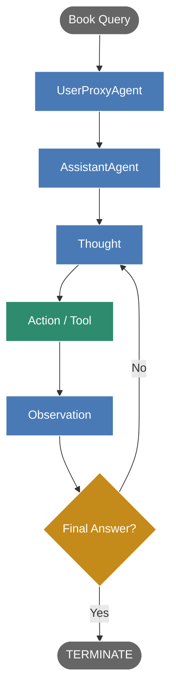

# `[react]-[ag2]-[ollama]`

> **Pattern** : ReAct (Reason + Act) · **Framework** : [AG2](https://github.com/ag2ai/ag2) · **Backend** : Ollama (local)

AG2's `AssistantAgent` is prompted with an explicit
`Thought → Action → Observation → Final Answer` loop, implementing the ReAct
pattern over a mock book catalogue. Same task as the LangGraph and CrewAI ReAct
versions — same tools, same rubric, direct CPCD comparison.


## Pattern Diagram



## Task

Book finder: given a title the user enjoyed, (1) look it up in the catalogue,
(2) fetch similar titles, (3) return structured recommendations with rationale.

**Tools available**

| Tool | Description |
|---|---|
| `search_book(title)` | Full and partial match against MOCK_BOOK_CATALOGUE |
| `get_similar_books(title)` | Returns 2 pre-mapped similar books |
| `get_book_rating(title)` | Returns the book's rating (0–5) |

## ReAct loop in AG2

```
user_proxy ──► assistant
                │
                ▼
         Thought: I should search for the book first.
         Action:  search_book("The Pragmatic Programmer")
                │
                ▼  (AG2 routes tool call → user_proxy executes → returns result)
         Observation: {"title": "The Pragmatic Programmer", "rating": 4.8, ...}
                │
                ▼
         Thought: Now I'll fetch similar books.
         Action:  get_similar_books("the pragmatic programmer")
                │
                ▼
         Observation: {"similar_books": [{...Clean Code...}, {...Refactoring...}]}
                │
                ▼
         Final Answer: Based on your enjoyment of ...
```

## AG2 vs LangGraph vs CrewAI (ReAct)

| Aspect | LangGraph | CrewAI | AG2 |
|---|---|---|---|
| **ReAct prompt** | Graph node + prompt template | Agent role + task | `system_message` with explicit T/A/O |
| **Reasoning trace** | Node execution log | Crew verbose log | Chat message history |
| **Tool loop** | Graph cycles | Task iteration | `max_consecutive_auto_reply` |
| **Termination** | `END` node | Task done | `is_termination_msg` |
| **Streaming** | LangGraph stream | CrewAI callback | AG2 message callback |

## CPCD comparison (illustrative)

| Framework | Quality score | Token cost (local) | CPCD |
|---|---|---|---|
| LangGraph | ~0.80 | $0.000000 | — |
| CrewAI | ~0.78 | $0.000000 | — |
| **AG2** | ~0.79 | $0.000000 | — |

> With local Ollama all costs are $0; replace with cloud model rates to see
> meaningful CPCD differentiation.

## Running

```bash
python agent.py
python agent.py "I liked 'Clean Code'. What should I read next?"
```

## Install

```bash
pip install ag2
ollama pull llama3.1:8b
```
