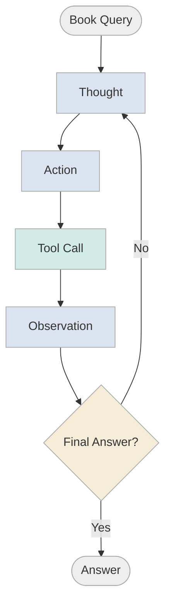

# ReAct — CrewAI + Ollama

**Pattern**: ReAct (Reason + Act) | **Category**: Reasoning Mechanics | **Framework**: CrewAI | **Backend**: Ollama (local)


## Pattern Diagram



## What this example does

A book-finder agent that searches a catalogue, checks availability, and suggests alternatives — using three tools: `search_books`, `check_availability`, and `get_similar_books`.

This is the **CrewAI implementation** of the same task as [`[react]-[langgraph]-[ollama]`](../[react]-[langgraph]-[ollama]/README.md). The task, mock data, rubric, and scoring are identical — only the framework differs, enabling direct CPCD comparison.

## Architectural note — ReAct in CrewAI

ReAct is a first-class concept in LangGraph: the graph explicitly alternates between `reason` and `act` nodes, and the cycle is visible in the execution trace.

CrewAI does not expose a named ReAct graph. Instead, a single agent with tools runs an internal thought → action → observation loop managed by the framework. The *behaviour* is equivalent — the agent reasons before each tool call and adapts its next step based on the tool's output — but the loop is implicit rather than explicit.

**This difference is itself a finding**: if CPCD is similar between the two versions, it suggests the explicit graph adds architectural clarity without meaningful cost. If CPCD diverges, it points to differences in token efficiency or loop control.

## How it differs from the LangGraph version

| Aspect | LangGraph | CrewAI |
|---|---|---|
| Tool definition | `@tool` decorator on plain functions | `BaseTool` subclass with `args_schema` |
| ReAct loop | Explicit graph (reason → act nodes) | Framework-managed internally |
| Agent construction | `create_react_agent(llm, tools)` | `Agent(role, goal, backstory, tools, llm)` |
| Execution | `graph.invoke({"messages": [...]})` | `crew.kickoff()` |
| Loop visibility | Visible in LangGraph trace | Visible in `verbose=True` output |

## Run it

```bash
cd reasoning/[react]-[crewai]-[ollama]
python agent.py
# or with a custom task:
python agent.py "Find a deep learning book. Check availability."
```

## Run the tests

```bash
pytest reasoning/[react]-[crewai]-[ollama]/tests/test_local.py -v
```

## Files

| File | Purpose |
|---|---|
| `agent.py` | CrewAI agent with three BaseTool subclasses |
| `config.yaml` | LLM backend settings (Ollama) |
| `rubric.yaml` | Identical to LangGraph version — same 4 criteria |
| `tests/test_local.py` | Unit tests for each tool class + mock catalogue |

---

← [Back to reasoning/](../README.md) · [LangGraph version](../[react]-[langgraph]-[ollama]/README.md) · [Full pattern catalogue](../../PATTERNS.md)
