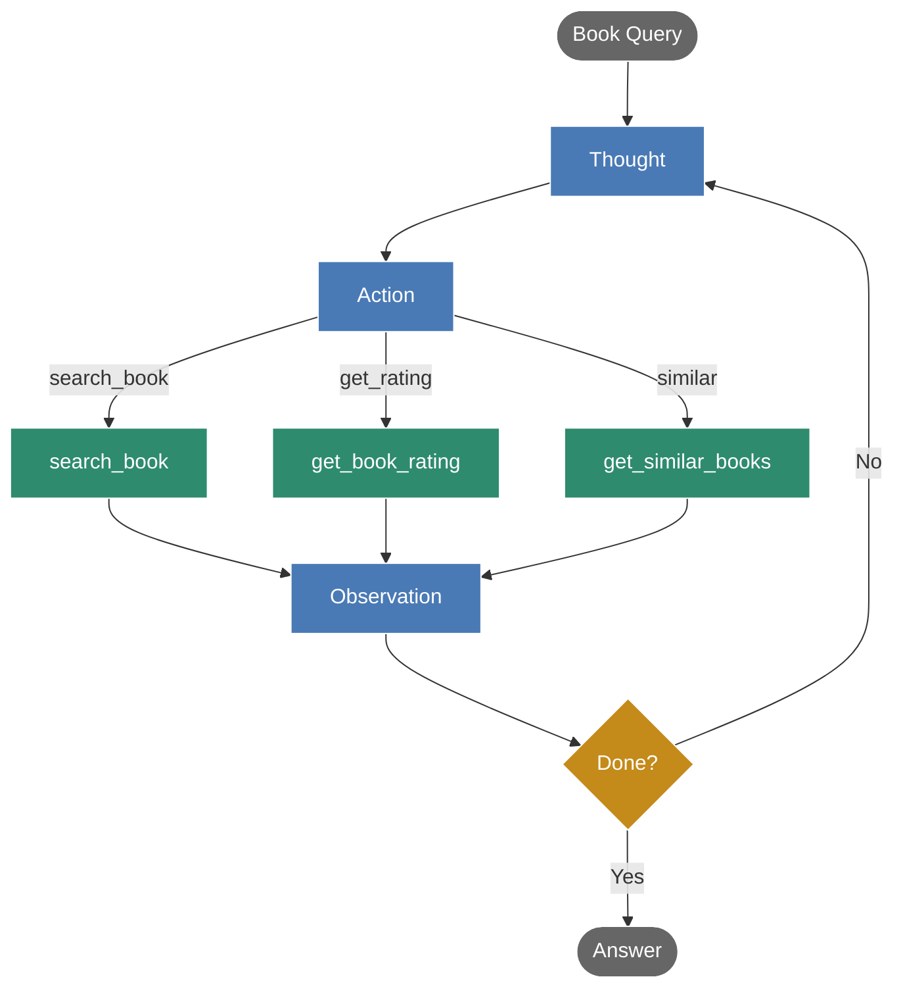

# `[react]-[langgraph]-[ollama]` — ReAct Pattern

> **Category**: Reasoning Mechanics | **Pattern**: ReAct | **Framework**: LangGraph | **Backend**: Ollama


## Pattern Diagram



## What This Example Demonstrates

The **ReAct (Reason + Act)** pattern: the agent alternates between Thought and Action, looping until it has enough information. Each observation can change the next thought.

**Scenario**: Book finder with three tools:
- `search_books(query)` — keyword search across a mock catalogue
- `check_availability(title)` — availability check
- `get_similar_books(title)` — alternatives when a book is unavailable

## Tool Use vs ReAct

| Dimension | Tool Use | ReAct |
|---|---|---|
| Loop | No — single tool call | Yes — Think → Act → Observe → repeat |
| Branching | Fixed | Conditional on prior observations |
| When to use | Known tool, known args | Outcome of one call decides the next |

## Flow

```
Task: "Find an ML book, check availability, suggest alternatives if unavailable."
  │
  ▼  Thought: I should search for ML books first.
  │  Action:  search_books("machine learning beginner")
  │  Observe: [{ title: "Python Machine Learning", available: True }, ...]
  │
  ▼  Thought: Found one. Let me verify availability.
  │  Action:  check_availability("Python Machine Learning")
  │  Observe: "'Python Machine Learning' is currently available."
  │
  ▼  Answer:  "Python Machine Learning by Sebastian Raschka is available."
```

## Quick Start

```bash
cd reasoning/[react]-[langgraph]-[ollama]
python agent.py
python agent.py "Find a deep learning book. If unavailable, suggest alternatives."
```

## When NOT to Use ReAct

- When only one tool call is needed — **Tool Use** is simpler
- When the full plan is known upfront — use **Plan-and-Execute**
- When you need guaranteed bounded steps — add a step counter
