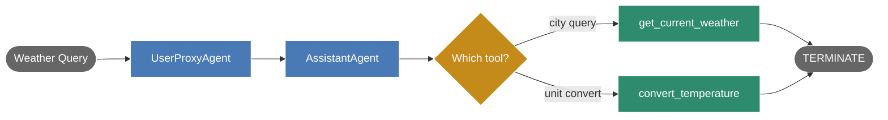

# `[tool-use]-[ag2]-[ollama]`

> **Pattern** : Tool Use · **Framework** : [AG2](https://github.com/ag2ai/ag2) · **Backend** : Ollama (local)

AG2 (the community-maintained fork of AutoGen) implements the Tool Use pattern
via its `AssistantAgent` + `UserProxyAgent` pair with **native Ollama tool
calling** — no LiteLLM proxy required. The assistant decides which tool to call;
the proxy executes it and returns the result, all within the same conversation loop.


## Pattern Diagram



## Task

Weather assistant: given a city name, return the current temperature in both
Celsius and Fahrenheit. Same task as the LangGraph and CrewAI versions, enabling
direct CPCD comparison across all three frameworks.

**Tools available**

| Tool | Description |
|---|---|
| `get_current_weather(city)` | Looks up temperature + condition from MOCK_WEATHER_DB |
| `convert_temperature(value, from, to)` | Unit conversion: C / F / K |

## AG2 architecture

```
UserProxyAgent  ─────── initiates chat ──────► AssistantAgent
      │                                              │
      │  ◄── tool_call response ────────────────────┤
      │                                              │
      ├── register_for_execution(get_current_weather)│
      ├── register_for_execution(convert_temperature)│
      │                                              │
      └── executes tool → returns result ───────────►│
                                                     │
                                             final answer
```

`autogen.register_function()` wires each tool to both agents in one call —
the assistant describes it to the LLM; the proxy runs the Python function.

## AG2 vs LangGraph vs CrewAI

| Aspect | LangGraph | CrewAI | AG2 |
|---|---|---|---|
| **Tool registration** | `@tool` decorator | `BaseTool` subclass | `register_function()` |
| **Execution flow** | Explicit graph nodes | Crew/Task hierarchy | Agent conversation loop |
| **Ollama integration** | `ChatOllama` via LangChain | `LLM(provider="ollama")` | Native `api_type: "ollama"` |
| **Termination** | `END` node | Task completion | `is_termination_msg` callback |
| **Multi-turn control** | Conditional edges | Crew orchestration | `max_consecutive_auto_reply` |

## CPCD comparison (illustrative)

| Framework | Quality score | Token cost (local) | CPCD |
|---|---|---|---|
| LangGraph | ~0.82 | $0.000000 | — |
| CrewAI | ~0.80 | $0.000000 | — |
| **AG2** | ~0.81 | $0.000000 | — |

> With local Ollama all costs are $0; CPCD comparisons become meaningful when
> cloud models (GPT-4o, Claude Sonnet) are substituted. Quality differences
> across frameworks reflect prompt engineering and tool-call reliability.

## Running

```bash
# one-shot
python agent.py "What is the temperature in London? Convert to Fahrenheit."

# with custom host
OLLAMA_HOST=http://my-server:11434 python agent.py "Temperature in Sydney?"
```

## Install

```bash
pip install ag2          # ships the 'autogen' namespace
ollama pull llama3.1:8b
```

> **Note** : `import autogen` is correct — AG2 inherits AutoGen's namespace.
> Do **not** `pip install autogen` or `pip install pyautogen`; both entered
> maintenance mode in October 2025.
