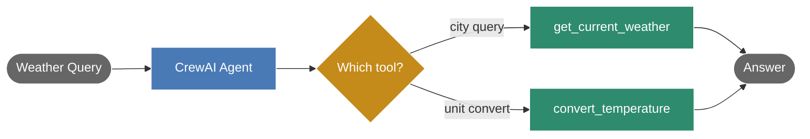

# Tool Use — CrewAI + Ollama

**Pattern**: Tool Use | **Category**: Reasoning Mechanics | **Framework**: CrewAI | **Backend**: Ollama (local)


## Pattern Diagram



## What this example does

A weather assistant that calls two tools — `get_current_weather` and `convert_temperature` — to answer questions like *"What is the current temperature in Tokyo? Convert it to Fahrenheit."*

This is the **CrewAI implementation** of the same task as [`[tool-use]-[langgraph]-[ollama]`](../[tool-use]-[langgraph]-[ollama]/README.md). The task, mock data, rubric, and scoring are identical — only the framework differs, enabling direct CPCD comparison.

## How it differs from the LangGraph version

| Aspect | LangGraph | CrewAI |
|---|---|---|
| Tool definition | `@tool` decorator on plain functions | `BaseTool` subclass with `args_schema` |
| Agent construction | `create_react_agent(llm, tools)` | `Agent(role, goal, backstory, tools, llm)` |
| Execution | `graph.invoke({"messages": [...]})` | `crew.kickoff()` |
| Tool loop | Explicit graph nodes (ReAct cycle) | Framework-managed internally |
| Answer extraction | `response["messages"][-1].content` | `str(result)` |

## Run it

```bash
cd reasoning/[tool-use]-[crewai]-[ollama]
python agent.py
# or with a custom task:
python agent.py "What is the weather in London? Convert to Kelvin."
```

## Run the tests

```bash
pytest reasoning/[tool-use]-[crewai]-[ollama]/tests/test_local.py -v
```

## Files

| File | Purpose |
|---|---|
| `agent.py` | CrewAI agent with two BaseTool subclasses |
| `config.yaml` | LLM backend settings (Ollama) |
| `rubric.yaml` | Identical to LangGraph version — same 4 criteria |
| `tests/test_local.py` | Unit tests for each tool class + mock DB |

---

← [Back to reasoning/](../README.md) · [LangGraph version](../[tool-use]-[langgraph]-[ollama]/README.md) · [Full pattern catalogue](../../PATTERNS.md)
