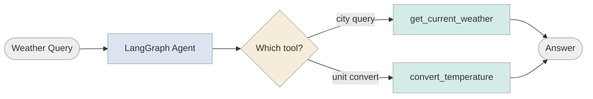

# `[tool-use]-[langgraph]-[ollama]` — Tool Use Pattern

> **Category**: Reasoning Mechanics | **Pattern**: Tool Use | **Framework**: LangGraph | **Backend**: Ollama


## Pattern Diagram



## What This Example Demonstrates

The **Tool Use** pattern: the agent selects a tool from a fixed set, calls it with arguments, and uses the result to answer. No reasoning loop — single-shot dispatch.

**Scenario**: Weather assistant with two tools:
- `get_current_weather(city)` — returns temperature and conditions from a mock DB
- `convert_temperature(value, from_unit, to_unit)` — unit conversion

## Key Concepts

| Concept | Detail |
|---|---|
| Tool decoration | `@tool` from `langchain_core.tools` |
| Agent | `create_react_agent(llm, tools=TOOLS)` |
| Single-shot | One tool call per question; no loop required |
| Scorer | LLM-as-Judge + CPCD via `_shared/scorer.py` |

## Flow

```
User question
     │
     ▼
LangGraph ReAct agent
     │
     ├──▶ get_current_weather("Tokyo")  ──▶  { temp_c: 22, condition: "Clear" }
     │
     └──▶ convert_temperature(22, "C", "F")  ──▶  { converted: 71.6, unit: "F" }
                                                            │
                                                            ▼
                                                   "Tokyo is currently 22°C (71.6°F), Clear."
```

## Quick Start

```bash
cd reasoning/[tool-use]-[langgraph]-[ollama]
python agent.py
python agent.py "What is the weather in Sydney? Convert to Kelvin."
```

## Files

```
[tool-use]-[langgraph]-[ollama]/
├── agent.py        ← Tools, graph, run_agent()
├── config.yaml     ← Model + scorer settings
├── rubric.yaml     ← Scoring criteria
├── tests/
│   └── test_local.py
└── README.md
```

## When NOT to Use Tool Use

- When intermediate results affect the next tool choice — use **ReAct**
- When no tools are needed — call the LLM directly
- When you need multi-step planning — use **Plan-and-Execute**
