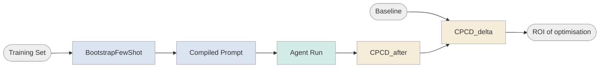

# `[prompt-opt]-[dspy]-[ollama]`

**Pattern** : Prompt Optimisation (Self-Improvement)  
**Category** : Self-Improvement  
**Framework** : [DSPy](https://github.com/stanfordnlp/dspy)  
**Backend** : Ollama (local)  

---


## Pattern Diagram



## What this demonstrates

DSPy treats prompts as *learnable parameters*. Instead of writing a prompt by
hand, you define a typed `Signature` (inputs + outputs + intent) and choose a
Module (`ReAct`, `ChainOfThought`, …). An Optimiser — here `BootstrapFewShot`
— then automatically generates and selects the best few-shot demonstrations
against a quality metric.

**The core self-improvement finding:**

```
Run baseline  →  CPCD_before
Run optimised →  CPCD_after
CPCD delta    =  CPCD_before − CPCD_after   (positive = improvement)
```

A smaller CPCD after optimisation means the agent produces higher quality per
dollar with no change to model weights.

---

## Task

Same as `reasoning/[tool-use]-[langgraph]-[ollama]` and the CrewAI version:

> *"What is the current temperature in Tokyo? Convert it to Fahrenheit."*

Identical rubric → CPCD is directly comparable across all three frameworks
**and** across the before/after optimisation axis.

---

## Architectural difference vs LangGraph / CrewAI

| Dimension | LangGraph / CrewAI | DSPy |
|---|---|---|
| Prompt | Hand-written | Compiler-generated |
| Tool loop | Graph node / agent loop | `dspy.ReAct` module |
| Improvement axis | Framework comparison (horizontal) | Before/after optimisation (vertical) |
| Self-improvement | ❌ Static | ✅ `BootstrapFewShot` |

---

## How DSPy connects to Ollama

DSPy uses LiteLLM under the hood. The `ollama_chat/` provider prefix routes
calls to the local Ollama server — no API key, no cloud cost.

```python
lm = dspy.LM(
    model    = "ollama_chat/llama3.1:8b",
    api_base = "http://localhost:11434",
    api_key  = "ollama",   # required by LiteLLM; not validated locally
)
dspy.configure(lm=lm)
```

---

## Run

```bash
cd reasoning          # any parent — path is set dynamically
python "self-improvement/[prompt-opt]-[dspy]-[ollama]/agent.py"

# with optimisation
python "self-improvement/[prompt-opt]-[dspy]-[ollama]/agent.py" --optimise

# custom question
python "self-improvement/[prompt-opt]-[dspy]-[ollama]/agent.py" \
    "What is the temperature in Sydney in Kelvin?"
```

## Test

```bash
pytest "self-improvement/[prompt-opt]-[dspy]-[ollama]/tests/test_local.py" -v
```

---

## CPCD comparison table (fill in after running)

| Run | Framework | Optimised | Quality Score | Token Cost | CPCD |
|---|---|---|---|---|---|
| 1 | LangGraph | — | | | |
| 2 | CrewAI | — | | | |
| 3 | DSPy | ❌ baseline | | | |
| 4 | DSPy | ✅ optimised | | | |

Rows 3→4 measure the **vertical CPCD delta** from self-improvement.

---

← [Back to self-improvement](../README.md) · [Full pattern catalogue](../../PATTERNS.md)
