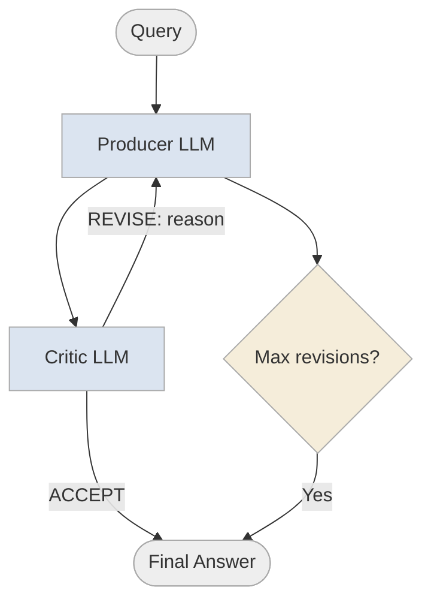

# `[research-swarm]-[ollama-harness]-[ollama]`

**Pattern** : Research Swarm / Self-Critique Loop  
**Category** : Self-Improvement  
**Framework** : [ollama-harness](https://github.com/upskilled-consulting/ollama-harness)  
**Backend** : Ollama (local)  

---


## Pattern Diagram



## What this demonstrates

ollama-harness runs a **producer-critique loop** entirely locally:

```
Producer agent  →  initial answer
Critique agent  →  ACCEPT or REVISE: <improved answer>
Producer agent  →  revised answer   (up to max_revisions)
```

<cite index="41-1">An LLM talks to the web, the filesystem, a browser, and itself —
search, synthesise, evaluate, revise, remember — with no cloud API required.</cite>

The key difference from DSPy: DSPy optimises the *prompt* across a training
set (batch, offline). ollama-harness refines the *answer* for a *single task*
at inference time (online, per-query).

---

## Fallback mode

If `ollama-harness` is not installed, the agent falls back to a built-in
producer-critique loop that calls the Ollama HTTP API directly using only
Python standard-library modules. CPCD is measured identically in both modes,
and the `harness_mode` field in the result distinguishes `"native"` from
`"fallback"`.

Install native:
```bash
pip install ollama-harness
```

---

## Task

Same weather question as all `reasoning/` and `self-improvement/` examples:

> *"What is the current temperature in Tokyo? Convert it to Fahrenheit."*

Identical rubric → CPCD is comparable across LangGraph, CrewAI, DSPy, and
ollama-harness.

---

## Self-improvement axis: iterations vs CPCD

```
iteration 1  →  CPCD_1   (producer draft)
iteration 2  →  CPCD_2   (after critique)
iteration 3  →  CPCD_3   (after second revision)
```

Each revision consumes tokens. The question agent-bench answers:
> *Does iterative critique improve quality enough to justify the extra token cost?*

---

## Run

```bash
python "self-improvement/[research-swarm]-[ollama-harness]-[ollama]/agent.py"

# custom question
python "self-improvement/[research-swarm]-[ollama-harness]-[ollama]/agent.py" \
    "What is the temperature in Sydney in Kelvin?"
```

## Test

```bash
pytest "self-improvement/[research-swarm]-[ollama-harness]-[ollama]/tests/test_local.py" -v
```

---

## Comparison with DSPy

| Dimension | DSPy | ollama-harness |
|---|---|---|
| Improvement scope | Prompt (across tasks) | Answer (per task) |
| When it runs | Before inference (compile) | During inference (loop) |
| Extra token cost | At compile time | Per query (each revision) |
| Self-improvement type | Batch / offline | Online / per-query |

Both are `self-improvement/` patterns — just at different points in the
agent lifecycle.

---

← [Back to self-improvement](../README.md) · [Full pattern catalogue](../../PATTERNS.md)
